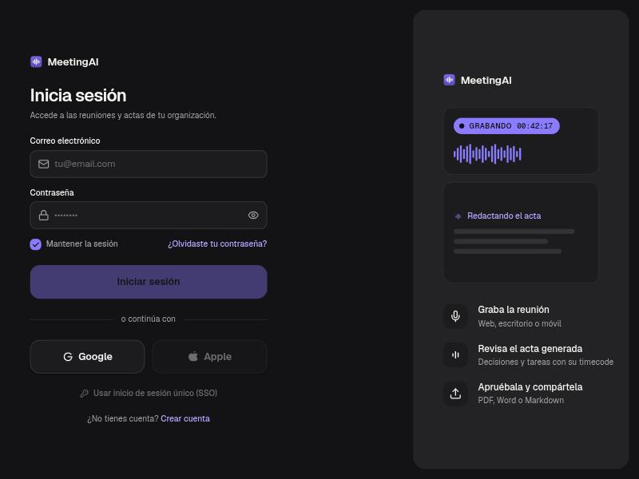
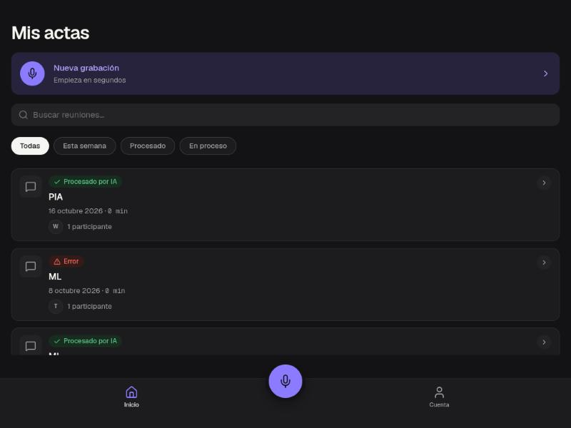
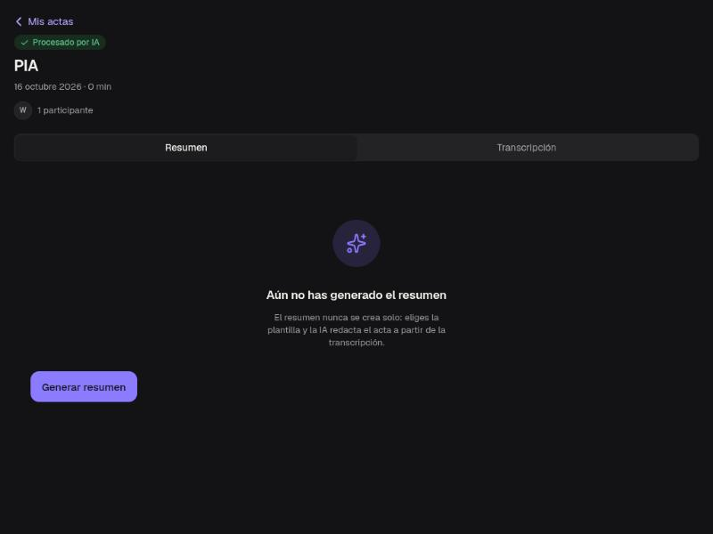

<div align="center">

# MeetingAI

**Graba una reunión. Recibe el acta.**

App móvil/web que graba, transcribe y resume reuniones con IA, y genera un acta
lista para compartir por WhatsApp, Gmail o cualquier canal — pensada para juntas
directivas, iglesias, asociaciones, ONGs y cualquier organización con reuniones
periódicas.

[](frontend)
[](frontend)
[](backend)
[](backend)
[](https://supabase.com)
[](https://mistral.ai)

</div>

<br>

<p align="center">
  
  
  
</p>

---

## Qué hace

1. **Graba** — desde el móvil, el escritorio o la web, con hasta 2 horas de audio por sesión.
2. **Transcribe** — el backend combina los clips y llama a Mistral (Voxtral) para transcribir, con diarización de interlocutores.
3. **Resume** — a partir de la transcripción, la IA redacta un acta con decisiones y tareas, con timecode de referencia.
4. **Comparte** — se descarga en PDF, Word o Markdown, o se envía por un enlace temporal (24h) sin que el destinatario necesite cuenta.

El modelo de datos es multi-tenant de verdad (organización → equipo → membresía con
roles), no un campo de texto libre — ver [ADR-003](docs/ADRs/ADR-003-modelo-multi-tenant.md).

## Por qué este repo es más que un CRUD

- **Arquitectura hexagonal + modular monolito** en el backend: 4 módulos
  (`grabacion`, `transcripcion`, `resumen`, `compartir`) que no se llaman entre sí
  directamente, solo por eventos de Spring o puertos de entrada explícitos — ver
  [ADR-002](docs/ADRs/ADR-002-arquitectura-hexagonal.md) y
  [`backend/CLAUDE.md`](backend/CLAUDE.md).
- **Auditoría de seguridad real, no un ejercicio**: una revisión completa del
  código encontró y cerró 3 vulnerabilidades de aislamiento multi-tenant (una
  organización por defecto compartida entre usuarios sin organización propia, un
  bucket de Storage con RLS sin predicado de organización, y una ruta de objeto
  sin validar que permitía robar audio ajeno) — cada fix con su migración
  versionada, su test unitario y **verificación en vivo contra producción** con
  dos usuarios/organizaciones reales antes y después del cambio. Documentado en
  la Nota de seguridad de [`backend/CLAUDE.md`](backend/CLAUDE.md).
- **Decisiones documentadas, no implícitas**: cada decisión técnica relevante
  tiene un ADR con el contexto, las alternativas descartadas y el motivo — ver
  [`docs/ADRs/`](docs/ADRs/).
- **Tests de dominio, no solo un smoke test**: la lógica de negocio (`Reunion`,
  `ClipAudio`, `Transcripcion`, `EnlaceCompartido`...) está probada con JUnit
  puro, sin Spring ni base de datos.

## Demo en vivo

- **Web:** [actas-app-frontend.vercel.app](https://actas-app-frontend.vercel.app)
- **API:** `https://actas-app.onrender.com` (plan gratuito de Render: el primer
  arranque tras inactividad puede tardar 20-40s)

## Stack

| Capa | Tecnología |
|---|---|
| Frontend | React Native + Expo SDK 57 (TypeScript estricto), React Navigation |
| Backend | Java 21 + Spring Boot 3.3.4, arquitectura hexagonal + modular monolito |
| Base de datos | PostgreSQL (Supabase), migraciones versionadas con Flyway |
| Storage | Supabase Storage, con políticas RLS por organización |
| Autenticación | Supabase Auth (JWT firmado con ES256, validado vía JWKS) |
| IA | Mistral AI — Voxtral (transcripción + diarización), modelos de combinación y resumen |
| Documentos | iText 7 (PDF) y Apache POI (Word) |
| Deploy | Backend en Render (Docker), frontend web en Vercel |

## Estructura del repositorio

```
actas-app/
├── backend/     → API en Java + Spring Boot (arquitectura hexagonal + modular monolito)
├── frontend/    → App en React Native + Expo (móvil + web)
└── docs/        → Documentación, ADRs y capturas
```

## Correrlo en local

### Backend

```bash
cd backend
mvn spring-boot:run
```

Arranca en el puerto 8080. Necesita un `backend/.env` (ignorado por git) con las
credenciales de Supabase y la API key de Mistral — ver
`backend/src/main/resources/application.yml` para las claves esperadas.

### Frontend

```bash
cd frontend
npm install
npx expo start
```

Necesita `EXPO_PUBLIC_API_URL`, `EXPO_PUBLIC_SUPABASE_URL` y
`EXPO_PUBLIC_SUPABASE_ANON_KEY` en `frontend/.env` (ignorado por git).

## Estado del proyecto

MVP en desarrollo activo (Sprint 1) — no un producto terminado. Autenticación
completa y permisos por rol ya tienen modelo de datos (ADR-003) pero su
aplicación fina sigue en marcha; generación de PDF/Word para el acta está
pendiente (hoy solo Markdown). El contexto completo, con el estado módulo a
módulo, vive en [`CLAUDE.md`](CLAUDE.md), [`backend/CLAUDE.md`](backend/CLAUDE.md)
y [`frontend/CLAUDE.md`](frontend/CLAUDE.md).

---

<div align="center">

Construido por **Wisdom Imade Isibor** · [github.com/WHubIJ](https://github.com/WHubIJ)

</div>
