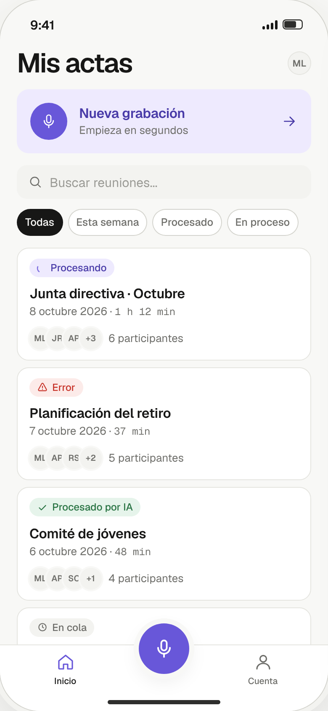

# MeetingAI (actas-app)

App móvil para grabar, transcribir y resumir reuniones de junta directiva u otros
órganos de gobierno (iglesias, asociaciones, ONGs, cooperativas, pequeñas empresas),
generando un acta que se puede compartir por cualquier canal (WhatsApp, Gmail,
Telegram, etc.) con el share sheet nativo del móvil.

**Estado: en desarrollo.** Sprint 1 (MVP núcleo) en curso — ver [`CLAUDE.md`](CLAUDE.md#sprint-actual)
para el detalle de épicas y qué falta.



*Captura del sistema de diseño (violeta/Geist) ya migrado al frontend — datos de
ejemplo genéricos, sin información real de ninguna organización.*

## Qué hace

1. **Grabar y subir audio** — graba la reunión en el dispositivo y lo sube directo
   a Supabase Storage.
2. **Transcribir** — el backend llama a una API de transcripción con el audio y
   guarda el texto resultante.
3. **Resumir y generar archivos** — genera un resumen con IA a partir de la
   transcripción y produce los archivos (PDF, Word o Markdown según el caso).
4. **Compartir** — abre el share sheet nativo del sistema operativo para enviar
   el archivo por cualquier app instalada.

## Stack técnico

| Componente | Tecnología |
|---|---|
| Backend | Java 21 + Spring Boot 3.3.4 |
| Base de datos | Supabase (Postgres) vía Spring Data JPA |
| Storage de audios | Supabase Storage (subida directa desde el frontend) |
| Autenticación | Propia, en Spring Boot (no Supabase Auth) |
| Frontend | React Native + Expo SDK 57 (TypeScript strict) |
| Transcripción y resumen | API externa de Mistral (Voxtral Mini Transcribe V2 + resumen) |
| Generación de archivos | iText 7 (PDF) y Apache POI (Word), en el backend |
| Notificaciones | Firebase Cloud Messaging / `expo-notifications` |

Detalle completo de arquitectura y decisiones en [`CLAUDE.md`](CLAUDE.md) y en
[`docs/ADRs/`](docs/ADRs/).

## Estructura del repositorio

```
actas-app/
├── backend/     → API en Java + Spring Boot
├── frontend/    → App móvil en React Native + Expo
├── design/      → Referencias visuales del sistema de diseño (previews HTML)
└── docs/        → Documentación, ADRs y backlog
```

## Cómo ejecutarlo

### Requisitos

- Java 21 y Maven (no hay Maven wrapper en el repo)
- Node.js y npm
- Un proyecto de Supabase (Postgres + Storage) y una API key de Mistral

### Backend

```bash
cd backend
cp .env.example .env   # rellenar con tus credenciales de Supabase/Mistral
mvn spring-boot:run    # arranca en http://localhost:8080
```

Variables de entorno esperadas (ver `backend/src/main/resources/application.yml`):
`SUPABASE_DB_URL`, `SUPABASE_DB_USER`, `SUPABASE_DB_PASSWORD`,
`SUPABASE_STORAGE_URL`, `SUPABASE_SERVICE_ROLE_KEY`, `MISTRAL_API_KEY`,
`FIREBASE_CREDENTIALS_PATH` (opcional).

### Frontend

```bash
cd frontend
npm install
npx expo start --web   # o npm run android / npm run ios
```

Variables de entorno (`frontend/.env`, prefijo `EXPO_PUBLIC_`):
`EXPO_PUBLIC_SUPABASE_URL`, `EXPO_PUBLIC_SUPABASE_ANON_KEY`, `EXPO_PUBLIC_API_URL`.
Sin ellas, las pantallas que dependen del backend fallan con un error explícito
en vez de simular un éxito.

Ningún `.env` se commitea (ver `.gitignore`); usa `backend/.env.example` como
plantilla para el backend.

## Documentación

- [`CLAUDE.md`](CLAUDE.md) — visión, stack, sprint actual y reglas del proyecto
- [`docs/00-Foundations/vision.md`](docs/00-Foundations/vision.md) — visión y alcance
- [`docs/01-Domain/modelo.md`](docs/01-Domain/modelo.md) — modelo de datos y reglas de negocio
- [`docs/ADRs/`](docs/ADRs/) — decisiones de arquitectura con contexto y alternativas descartadas
